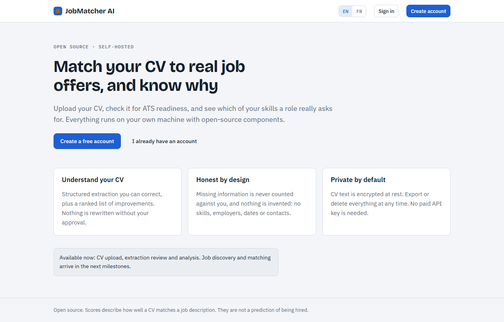
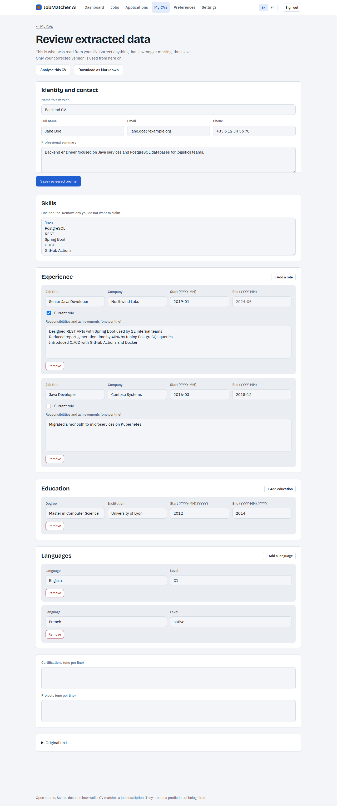
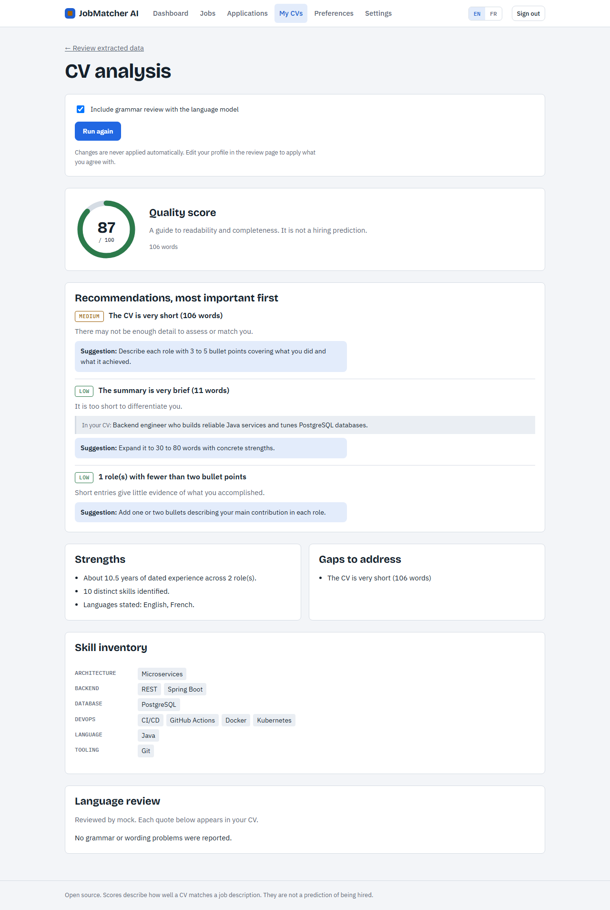
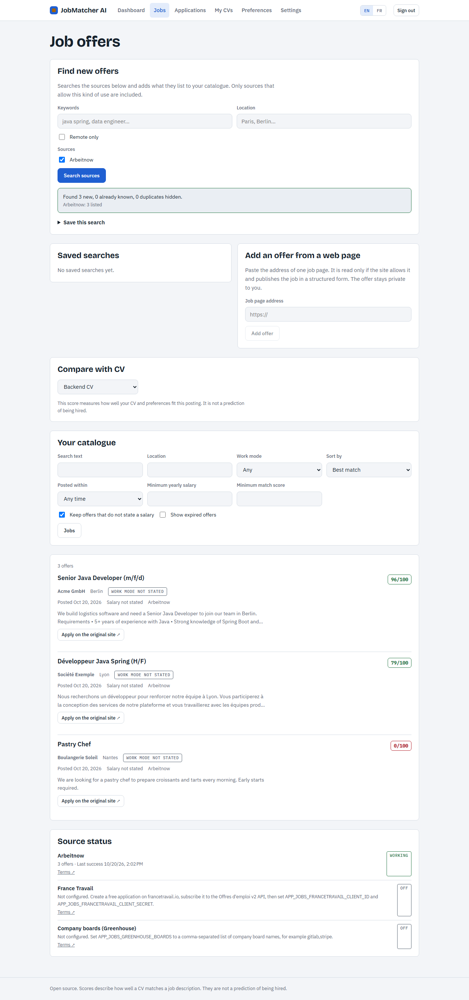
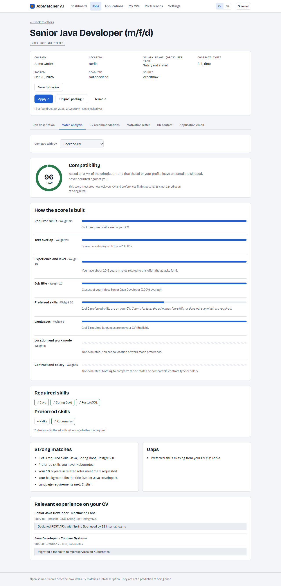
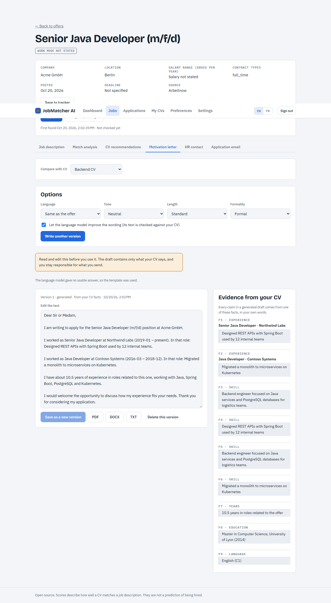
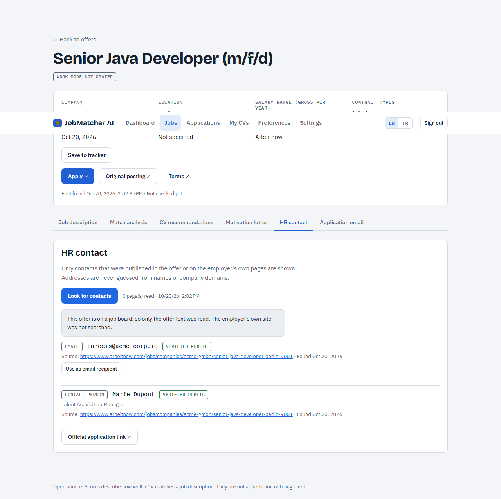
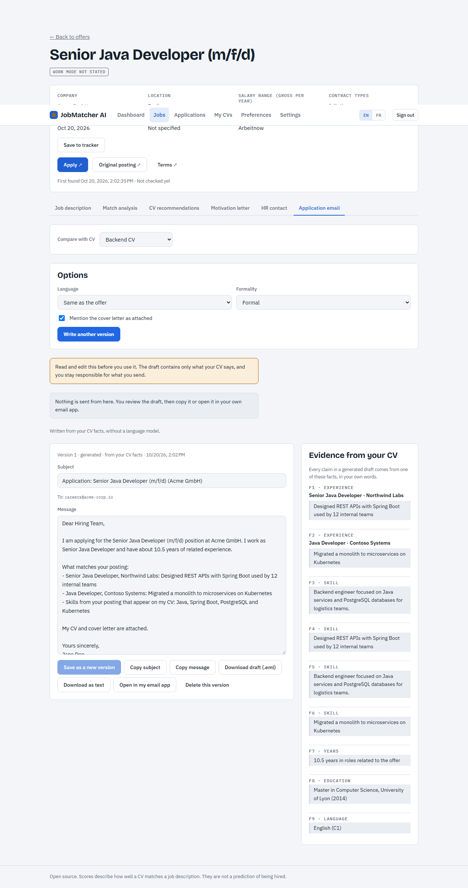
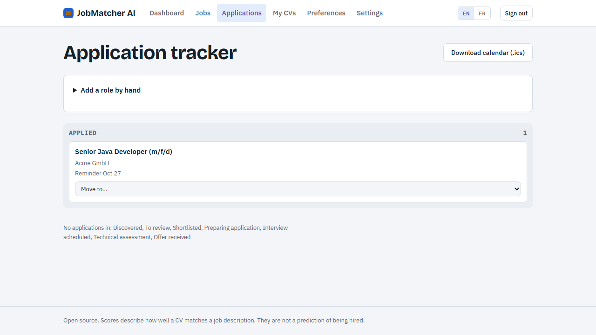
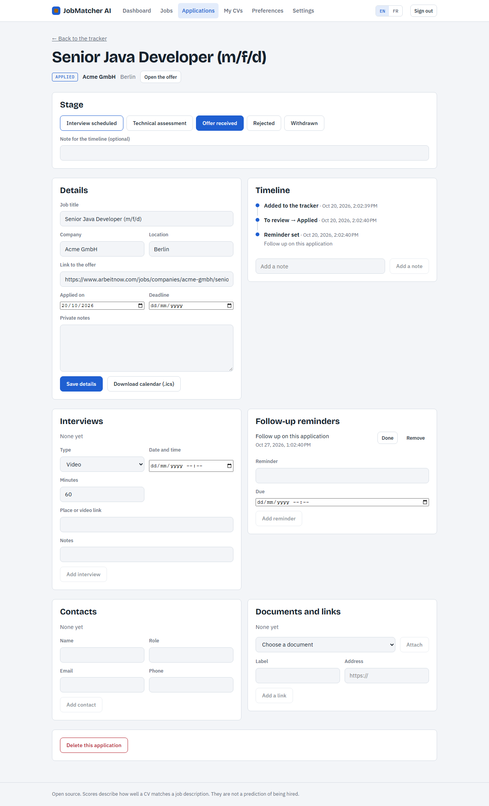

# JobMatcher AI

Open-source, self-hosted CV analysis and job search. Upload a CV, correct what was extracted, get a ranked list of improvements, and collect real job offers from sources that allow it. Every offer gets an explainable match score against your reviewed CV, and you can write a grounded cover letter and application email for it, then follow the application through to an offer.

> **Status: v0.2.0.** Milestones M0 to M7 are done: foundation, identity and CV, job discovery, matching, letters and HR contacts, the application tracker, hardening, and the extras (job alerts, statistics, scam warnings, CV comparison, learning plan, interview preparation, employer overview). See [docs/roadmap.html](docs/roadmap.html) for the original plan.

## What works today

| Area | Details |
|---|---|
| Accounts | Register, login, logout. Argon2id password hashing, cookie sessions, CSRF protection, per-client rate limits. |
| CV intake | PDF and DOCX upload (type checked from magic bytes, macros and zip bombs rejected), or paste text. Only text is stored; the file is discarded. |
| Extraction | French and English CVs to structured data: contact, summary, skills with evidence, dated experience, education, languages, certifications, years of experience. Unknown stays empty. |
| Review | The user corrects every field before it is used. Reviewed state is tracked per CV version. |
| Analysis | Deterministic checks (contact, structure, length, measurable results, weak phrasing, date consistency, layout) ranked by importance, plus an optional language-model grammar review whose quotes must exist in the CV. |
| Preferences | Titles, technologies, seniority, salary, contract, remote mode, countries, relocation, visa, notifications. All optional. |
| Privacy | CV text and parsed profile encrypted with AES-256-GCM before reaching the database. Data export (JSON) and full account deletion. |
| Job discovery | Source adapters: Arbeitnow (no setup), Greenhouse company boards and France Travail (need configuration), plus any single page that publishes schema.org `JobPosting` data. Cross-source duplicate detection, expiry detection, saved and automatic searches, source health, filters, sorting and paging. Missing data stays "not stated". |
| Matching | A 0-100 compatibility score per offer and CV with the reasons behind it: eight weighted criteria, required versus preferred skills, evidence from the CV, gaps, blockers (visa, salary, closed offer), CV adjustment suggestions and learning priorities. Unknown information is skipped, never penalised. Sort and filter offers by score. Method and weights: [docs/scoring.md](docs/scoring.md). |
| Letters and emails | Cover letters in French or English from facts copied out of your CV (tone, length, formality), optional language-model rewrite that is rejected if it adds anything not in the CV, evidence panel, version history, edit warnings, export to PDF, DOCX and TXT. Application email drafts with copy buttons, `.eml` download and `mailto:`. Nothing is ever sent. See [docs/documents.md](docs/documents.md). |
| HR contacts | Recruiting emails, named contacts and application links that were published in the offer or on the employer own pages, each with its source and date, verified or unverified. Addresses are never guessed; if none exists the page says so and links to the official application page. |
| Application tracker | Save an offer (or a role found elsewhere) to a board with ten stages and only legal moves, a full timeline, notes, contacts, interviews, follow-up reminders, letter and email attachments, and a warning before you track the same role twice, even if it was posted on another source. Calendar export (.ics) for interviews, reminders and deadlines. Personal text is encrypted. See [docs/tracker.md](docs/tracker.md). |
| Alerts and notifications | An automatic saved search tells you, once per run, about new offers that fit it and score at least your chosen minimum against your CV. Due follow-ups and interviews within 24 hours are announced too. In-app only; both kinds can be switched off. See [docs/extras.md](docs/extras.md). |
| Statistics | Funnel, stages, countries, roles, most requested skills, time per stage and results per CV, from your own applications only, with a small-sample caution. |
| Warnings | Plain-pattern checks (fees asked, identity or bank documents, messaging-app contact, unrealistic pay, pressure) shown with the quoted words. Warnings, never accusations. |
| CV comparison | Two versions side by side: readability, skills shown for a job, and factual differences (dates, employers, degrees). |
| Learning and interview prep | A learning plan from the gaps in your open applications with curated free resources; interview questions built from the ad and your CV, with a mock mode that stores nothing. |
| Safe fetching | One outbound path: public addresses only, ports 80/443, redirects re-checked, size and time caps, per-host spacing, robots.txt for web pages. |
| UI | Angular standalone components, signals, English and French interface, light and dark themes. |

## Walkthrough

Screenshots are produced by the end-to-end test (`SCREENSHOTS=1 npx playwright test` in `e2e/`), so they always show the real
application.

| | |
|---|---|
| **1. Create an account** and upload a PDF or DOCX, or paste text<br> | **2. Review what was extracted** and correct it before it is used<br> |
| **3. Analyse the CV**: ranked recommendations, skill inventory<br> | **4. Discover offers** from sources that allow it<br> |
| **5. Understand the match**: every criterion, skill and gap explained<br> | **6. Write a letter** from facts in your CV, with the evidence beside it<br> |
| **7. Look for published HR contacts**: sources, dates, verified or not<br> | **8. Prepare the email**: copy it, download it, or open it in your own mail app<br> |
| **9. Track the application** from review to offer<br> | **10. Follow the timeline**, reminders, contacts and interviews<br> |

## Documentation

| | |
|---|---|
| [Installation and deployment](docs/install.md) | Docker, development setup, HTTPS, troubleshooting |
| [Architecture](docs/architecture.md) and [database diagram](docs/erd.md) | components, trust boundaries, tables |
| [Scoring method](docs/scoring.md) | how a match score is computed and changed |
| [Letters, emails and HR contacts](docs/documents.md) | grounding rules, exports, contact discovery |
| [Application tracker](docs/tracker.md) | stages, duplicates, reminders, calendar |
| [Alerts, statistics and preparation tools](docs/extras.md) | notifications, analytics, warnings, comparison, learning, interview, employer overview |
| [Adding a job source](docs/adding-a-job-source.md) | the adapter interface and its rules |
| [Security](SECURITY.md), [Contributing](CONTRIBUTING.md), [Changelog](CHANGELOG.md) | |
| [Third-party licenses](docs/THIRD_PARTY.md) | components, models and data sources |
| [Roadmap](docs/roadmap.html) | the original plan and milestones |

## Quick start (Docker)

Requirements: Docker with Compose v2.

The Angular frontend lives in its own repository. Clone it into `frontend/` next to `backend/` before building:

```bash
git clone <frontend-repository-url> frontend
```

```bash
cd infra
cp .env.example .env
# put 32 random bytes in APP_ENCRYPTION_KEY:  openssl rand -base64 32
# set DB_PASSWORD to anything
docker compose --env-file .env up --build
```

Open http://localhost:8088. With `AI_PROVIDER=ollama` (the default), start the model service as well:

```bash
docker compose --env-file .env --profile ai up --build
```

This pulls `qwen3:8b` (about 5 GB). On a CPU-only machine set `OLLAMA_MODEL=qwen3:4b`. Without a model, set `AI_PROVIDER=mock`; everything works except the grammar review, which reports that it was skipped.

> **Back up `APP_ENCRYPTION_KEY`.** Losing it makes stored CVs unreadable.

## Development

Requirements: Java 21, Node.js 22.22 or newer (Angular 22), Docker (for the database and the integration tests).

```bash
# database
docker run --rm -d --name jm-db -p 5432:5432 -e POSTGRES_DB=jobmatcher -e POSTGRES_USER=jobmatcher \
  -e POSTGRES_PASSWORD=jobmatcher pgvector/pgvector:pg17

# API (http://localhost:8080, OpenAPI UI at /api/docs)
cd backend
APP_ENCRYPTION_KEY=$(openssl rand -base64 32) AI_PROVIDER=mock ./mvnw spring-boot:run

# web (http://localhost:4200, proxies /api to :8080)
cd frontend
npm ci && npx ng serve
```

### Tests

```bash
cd backend  && ./mvnw verify          # unit + integration (Testcontainers starts PostgreSQL)
RUN_LIVE_TESTS=true ./mvnw test -Dtest=LiveSourcesTest   # optional: calls the real Arbeitnow API
cd frontend && npx ng test --watch=false
```

Backend tests use the deterministic `mock` AI provider and synthetic CVs (see `backend/src/test/java/ai/jobmatcher/cv/Fixtures.java`); no real personal data is used. Integration tests are skipped automatically when Docker is not available.

## Architecture

```
Angular SPA ──/api──▶ Spring Boot API ──▶ PostgreSQL (Flyway migrations, pgvector image)
 (nginx)                  │
                          ├──▶ SafeFetcher ──▶ job sources (Arbeitnow, Greenhouse, France Travail, user URLs)
                          ├──▶ TextGenerator port ──▶ Ollama | OpenAI-compatible (planned) | Mock
                          └──▶ Apache Tika (in-process, size/time capped)
```

More in [docs/architecture.md](docs/architecture.md).

Backend packages (`ai.jobmatcher`): `auth`, `profile`, `cv`, `account`, `ai`, `common`, `config`. Each feature keeps web, service and persistence code together. Business code depends on the `TextGenerator` interface only.

## Configuration

| Variable | Default | Purpose |
|---|---|---|
| `APP_ENCRYPTION_KEY` | none, required | Base64 32-byte AES key for CV data at rest |
| `DB_URL`, `DB_USER`, `DB_PASSWORD` | local Postgres | Database connection |
| `AI_PROVIDER` | `ollama` | `ollama` or `mock` |
| `OLLAMA_URL`, `OLLAMA_MODEL` | `http://localhost:11434`, `qwen3:8b` | Local model settings |
| `COOKIE_SECURE` | `false` | Set `true` behind HTTPS |
| `APP_MATCHING_WEIGHTS_*` | 30/20/15/10/10/5/5/5 | Relative weight of each matching criterion |
| `APP_JOBS_GREENHOUSE_BOARDS` | empty | Comma-separated company board names to read |
| `APP_JOBS_FRANCETRAVAIL_CLIENT_ID`, `..._CLIENT_SECRET` | empty | Free credentials from francetravail.io |

Rate limits and upload caps live under `app.*` in `backend/src/main/resources/application.yml`.

### Adding a job source

Implement `JobSourceAdapter` and register it as a bean; see [docs/adding-a-job-source.md](docs/adding-a-job-source.md). Terms for each shipped source are listed in [docs/THIRD_PARTY.md](docs/THIRD_PARTY.md).

### Using a different local model

Any model Ollama can serve works: `ollama pull <name>` and set `OLLAMA_MODEL=<name>`. To add another provider, implement `ai.jobmatcher.ai.TextGenerator` (three methods) and register it in `AiConfig`. Check each model's license before use; the default `qwen3` family is Apache-2.0.

## Privacy and safety notes

- CV and job text is treated as untrusted data. The language model is given no tools and no network access, and it only returns JSON that is validated; every grammar issue must quote text found in the CV.
- Nothing is invented. Missing fields stay empty; suggestions never contain figures or facts.
- Scores describe CV quality or fit, not the probability of being hired.
- Job text is stored as plain text only, and external links are shown only when they are http(s).
- The score is a measure of fit with a posting, not a probability of being hired, and identifying fields (name, email, phone) never influence it.
- Known limitations: letters and emails exist in French and English only (offers in other languages get a draft in a supported one, with a note); template prose quotes CV wording, so it is plain; contacts are rarely published on job boards, so many offers will show none; text similarity is lexical, not semantic (embeddings are planned); skill detection uses a curated dictionary; the France Travail adapter is tested against a fixture, not the live service; the SSRF guard checks addresses before connecting, so a hostile DNS server that changes its answer between check and connection is a residual risk; scanned PDFs need OCR, which is not enabled yet (the app says so and asks for pasted text); the in-memory rate limiter assumes a single API instance; extraction is heuristic, so the review step matters.

## License

Apache-2.0, see [LICENSE](LICENSE). Third-party components and models: [docs/THIRD_PARTY.md](docs/THIRD_PARTY.md).
