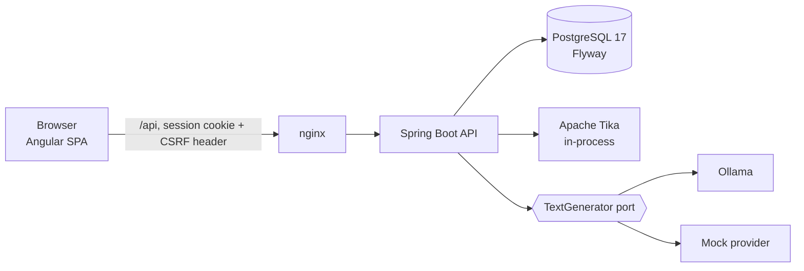
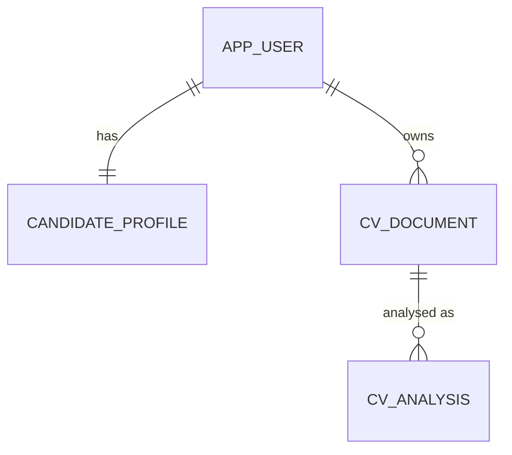

# Architecture

## Runtime view

The browser only ever talks to the API. The API is the single place that reads uploads, calls the model and touches the database.

## Request path for a CV upload

1. `CvController` rate-limits per user, then hands the bytes to `CvService`.
2. `UploadValidator` decides the type from magic bytes, checks the extension matches, and for DOCX inspects the zip (entry count, expanded size, macro parts, path traversal).
3. `TextExtractor` runs Tika on a worker thread with a character cap and a timeout.
4. `CvParser` produces `ParsedCv`; `SkillCatalog` supplies the bilingual skill dictionary.
5. Text and parsed JSON are encrypted by `FieldCrypto` and saved; the file bytes are dropped.
6. The user reviews and saves a corrected `ParsedCv`; analyses run on that data.

## Trust boundaries

| Input | Treated as | Controls |
|---|---|---|
| Uploaded file | hostile | magic-byte typing, size caps, zip inspection, parse timeout, text cap, never stored |
| CV text | untrusted data | passed to the model inside delimiters with no tools; model output is schema-checked and quote-verified |
| Browser requests | authenticated per session | CSRF double-submit, owner-scoped queries (`findByIdAndUserId`), 404 for foreign ids |

## Data model (current migration V1)

All user tables reference `app_user` with `ON DELETE CASCADE`, so deleting an account removes everything in one statement. Planned tables (jobs, matches, documents, applications) arrive with their milestones; see `roadmap.html`.

## Decisions

- **Maven, not Gradle.** Spring Initializr's Gradle generation was failing when the project was created; Maven works the same for this project.
- **Cookie sessions, not JWT.** Same-origin SPA, revocable sessions, no token in script-readable storage.
- **Text only, no file storage.** Reduces privacy exposure and removes a class of file-serving bugs.
- **Deterministic first.** Parsing and analysis work with no model. The model adds optional value and can never add facts.
- **Notifications are codes plus parameters.** The API stores `alert.newMatches` and a small JSON object; the browser renders it in the
  language it is showing. Private text (a reminder's note) is never copied into a notification.
- **Alerts reuse the matching engine.** `AlertService` scores new offers with `MatchService`, so an alert and the job page can never
  disagree. It runs only after automatic searches, never after a manual one.
- **Warnings are a pure function of the ad.** `JobQualityAnalyzer` has no state and no network access; each hit carries its quote.
- **Comparison reports, it does not arbitrate.** `CvComparisonService` lists differences between two CVs and leaves the choice to the user.
- **Curated, not generated, resources.** Learning links come from a reviewed CSV and a link-check script, because a model-made link
  can point nowhere.
- **Interview scaffolds are prompts.** They quote the CV and frame an answer; they do not write one.
- **Employer overview is a count of what was seen.** No scraping for reviews or financials: none of it could be cited.
