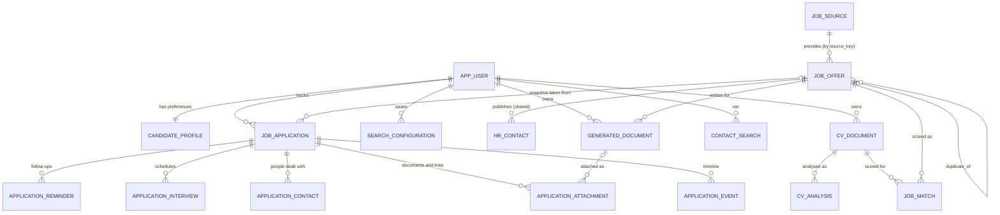

# Database entity relationship diagram

Source of truth: `backend/src/main/resources/db/migration/V1` to `V5`. Tables marked *shared* hold public job data and carry no
personal information; every other table is owned by a user and removed with the account (`ON DELETE CASCADE`).

| Table | Purpose | Notable columns and constraints |
|---|---|---|
| `app_user` | account | unique email; `consent_at`; language check (`en`, `fr`) |
| `candidate_profile` | job-search preferences | one per user; salary range check |
| `cv_document` | one CV version | `extracted_text` and `parsed_json` **encrypted**; `reviewed` |
| `cv_analysis` | stored analysis report | score 0 to 100 |
| `job_source` | source health | failures in a row, last error, last success |
| `job_offer` *shared* | normalised offers | unique `(source_key, external_id, owner)`; `fingerprint`; `status`; `duplicate_of`; private to `owner_user_id` when user-submitted |
| `search_configuration` | saved and automatic searches | interval 1 to 168 hours; `min_score` 0 to 100 for alerts |
| `job_match` | score of one CV against one offer | `stamp` records the inputs, so outdated scores are never shown; report **encrypted** |
| `generated_document` | letter or email version | unique `(user, job, type, version)`; subject, body, facts **encrypted** |
| `hr_contact` *shared* | published contacts | `source_url`, `source_kind`, `verified`, `discovered_at`; unique `(job, kind, value)` |
| `contact_search` | a contact search ran | distinguishes "nothing found" from "not searched" |
| `job_application` | tracked role | snapshot of title, company, link; status check; notes **encrypted** |
| `notification` | in-app alert (new matches, due reminder, interview soon) | code and JSON parameters, no free text from other tables; deleted after 90 days |
| `application_event` | append-only timeline | note **encrypted** |
| `application_contact` / `_interview` / `_reminder` / `_attachment` | details of an application | free text **encrypted** |

## Retention

- Offers expired for more than 180 days (`app.retention.expired-offers-days`) are deleted nightly unless a letter, email or
  application still refers to them. Applications keep their own snapshot.
- Everything a user created is deleted with the account, which the Account page triggers after a password check.
- Uploaded files are never stored; only extracted text is.
