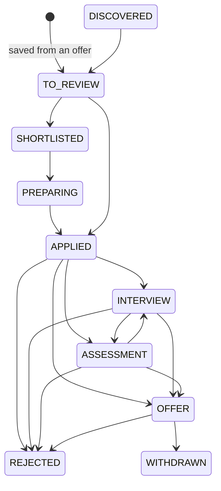

# Application tracker

## Stages and allowed moves

`DISCOVERED`, `TO_REVIEW`, `SHORTLISTED`, `PREPARING`, `APPLIED`, `INTERVIEW`, `ASSESSMENT`, `OFFER`, `REJECTED`, `WITHDRAWN`.

The diagram shows the main path. The authoritative rules are in `ApplicationStatus.java`, exposed to the UI as `allowedNext`, so
the interface can never offer a move the server would refuse. Highlights: any open stage can be withdrawn; `REJECTED` and
`WITHDRAWN` are final; nothing can be rejected before it was sent; an application cannot jump from "discovered" to "offer".
An illegal move answers `409`. Every move is recorded in the timeline with its optional note and time, which is also the data
behind the stage-duration statistics planned for the analytics milestone.

## What an application holds

Title, company, place and link are copied from the offer at the time of saving, so the record survives the offer expiring or
being removed. Around that:

- **Timeline** (append-only): created, each status move, notes, contacts, interviews, reminders, attachments.
- **Notes, contacts, interviews** (type, time, length, place or video link, notes), **follow-up reminders**.
- **Attachments**: a version of a letter or email written in this app, or a link (portal, assessment, offer letter). Files are
  not uploaded or stored.
- **Dates**: applied on, deadline (taken from the offer when it states one).

Everything the user writes, and every third-party contact detail, is encrypted at rest (AES-256-GCM) like the CV text.

## Duplicates

Before an application is created, the tracker looks for the same offer, or the same role under another id: same title, company
and city after normalising case, accents, gender markers (`m/f/d`) and legal forms (`Acme`, `Acme GmbH`, `ACME Inc.`). A match
returns `409 duplicate-application` with the existing applications; the client shows them and the user can confirm
(`confirmDuplicate: true`). The UI also checks as soon as an offer page opens.

## Reminders and the calendar

Reminders are shown on the dashboard and the board, with overdue ones highlighted. Applying can create one automatically
("follow up after N days"). Nothing is pushed or emailed; email and in-app notifications arrive with the alerts milestone.
`GET /api/applications/calendar.ics` (all applications, or `?applicationId=`) returns a standard calendar file with interviews,
open reminders and the application deadline of roles not yet applied to, each with a display alarm at its start time.
